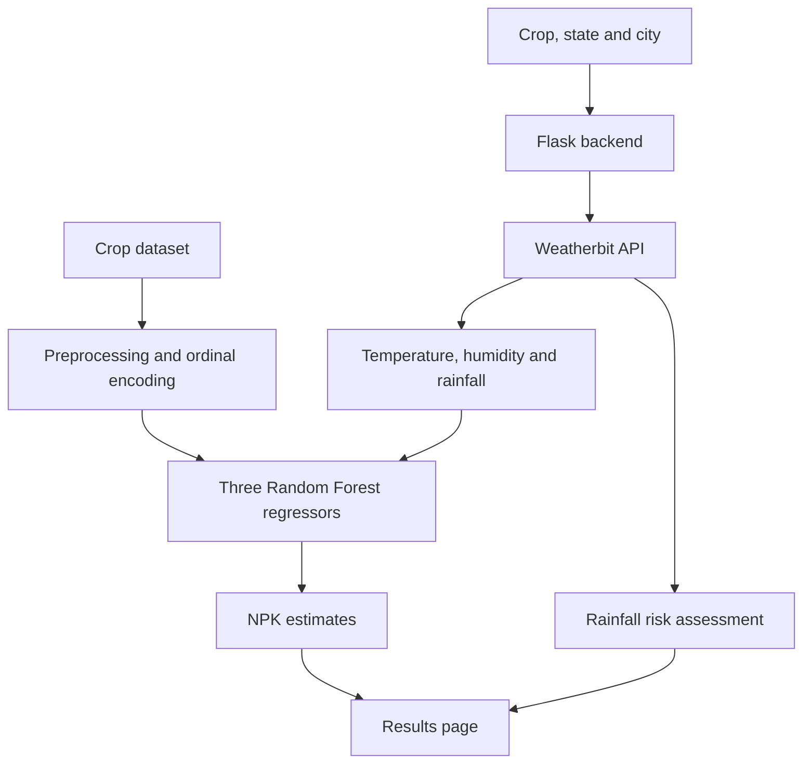

# EcoFertilization — ML-Based Nutrient Recommendation


EcoFertilization is a full-stack machine learning application that estimates crop-specific nitrogen, phosphorus and potassium (NPK) values using agricultural data and location-specific weather forecasts. It supports sustainable fertiliser planning through nutrient predictions and rainfall risk alerts.

## Key features

- Nutrient estimation across **22 crop varieties** using **2,200 agricultural records**.
- Three independent Random Forest regressors with **50 decision trees each**.
- Weatherbit REST API integration for **7-day forecasts** and heavy rainfall alerts.
- Interactive Flask web interface for crop and location selection, predictions and weather reports.

## Architecture



## Model development

| Component | Details |
|---|---|
| Dataset | 2,200 records; 80:20 train-test split |
| Inputs | Crop, temperature, humidity, rainfall |
| Targets | Nitrogen, phosphorus, potassium |
| Models | 3 Random Forest regressors; 150 trees total |
| Hyperparameter experiments | 19 candidate estimator counts |
| Reported nitrogen model score | R² approximately 0.87 |

The publication also reports 92% overall performance, without clearly defining the aggregate metric. Results have not been independently reproduced.

## Tech stack

Python · pandas · NumPy · scikit-learn · Matplotlib · Flask · Requests · Weatherbit API · HTML · CSS · JavaScript

## Project structure

```text
├── app.py                         # Flask application
├── BestTimeToFertilizeModule.py     # Weather API and rainfall alerts
├── NPKEstimatorModule.py            # Nutrient regression models
├── Nutrient_recommendation.csv     # Agricultural dataset
├── templates/                     # HTML templates
└── static/                        # Frontend assets
```

## Getting started

```bash
git clone https://github.com/SARANYA233/Machine-learning-based-Nutrient-Recommendation-system-for-soil-fertilisation.git
cd Machine-learning-based-Nutrient-Recommendation-system-for-soil-fertilisation
python -m venv .venv
```

Activate the virtual environment (`source .venv/bin/activate` on Linux/macOS or `.\\.venv\\Scripts\\Activate.ps1` in Windows PowerShell), then install dependencies:

```bash
python -m pip install flask requests numpy pandas scikit-learn category-encoders matplotlib
```

Obtain a Weatherbit API key. Replace the hardcoded key in `BestTimeToFertilizeModule.py` with an environment variable:

```python
import os
# Inside the BestTimeToFertilize class:
__API_KEY = os.environ["WEATHERBIT_API_KEY"]
```

Set `WEATHERBIT_API_KEY` in your environment, then run:

```bash
python app.py
```

Open **http://localhost:5000**, select a crop, state and city, and submit the form to view the predictions and forecast. Setup commands have not been execution-tested.

## Research publication

**Machine Learning Based Nutrition Recommendations System for Soil Fertilization** — JETIR, May 2023, Vol. 10, Issue 5, pp. f172–f177. Article ID: JETIR2305527.

Authors: J. S. Sowmiya, Saranya S., K. Sriponbala, Sarangam Sai Indu and A. Swathi.

[Dataset source](https://www.kaggle.com/datasets/atharvaingle/crop-recommendation-dataset) · [Journal](https://www.jetir.org/)

## Limitations

This is an academic prototype, not a field-validated fertiliser prescription tool. Models are currently trained per request; future improvements include persisting trained models, validating feature units and improving regression evaluation. Rotate any exposed API credentials before use.
